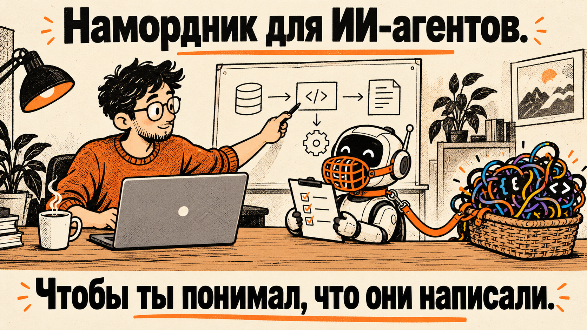

# RotProof

**Build with AI. Prove you understand it.**

RotProof — переносимый комплект для разработки с AI, который помогает не терять понимание проекта за сгенерированным кодом. Он задаёт правила утверждения решений, разбивает работу на проверяемые срезы и позволяет проверять объяснения по исходникам.

## Быстрый старт нового проекта

1. Скопируй `AGENTS.md` в корень проекта, а `docs/` — в каталог документации.
2. Сохрани `prompts/`, `USE_CASES.md` и `checklists/` в доступном тебе и команде месте.
3. Подготовь продуктовый замысел через [`prompts/draft-product.md`](prompts/draft-product.md). После утверждения помести согласованный текст в `docs/PRODUCT.md`.
4. Запусти [`prompts/initialize-project.md`](prompts/initialize-project.md), чтобы разобрать проект и получить первый вертикальный срез.
5. Утверди границы и критерии, затем используй [`prompts/implement-approved-slice.md`](prompts/implement-approved-slice.md).

Для внедрения в уже работающий проект начни с [`prompts/adopt-existing-project.md`](prompts/adopt-existing-project.md). Он поможет инвентаризировать имеющиеся правила и документы, не затирая их.

## Рабочий цикл

1. Агент изучает правила, документы, код и состояние Git.
2. Агент предлагает сценарий, границы, критерии проверки и открытые решения — без изменений файлов.
3. Ты утверждаешь подход и решения, которые относятся к твоей ответственности.
4. Агент реализует только утверждённый срез, сверяет diff и сообщает тебе о фактически выполненных проверках.
5. Ты принимаешь результат и отдельно решаешь вопрос о commit, merge или публикации.

Подробные варианты смотри в [`USE_CASES.md`](USE_CASES.md).

## Сценарии и prompts

- [Начать новый проект](prompts/initialize-project.md)
- [Внедрить комплект в существующий проект](prompts/adopt-existing-project.md)
- [Спроектировать фичу](prompts/propose-feature.md)
- [Спроектировать рефакторинг](prompts/propose-refactor.md)
- [Составить roadmap без реализации](prompts/plan-roadmap.md)
- [Подготовить PRODUCT.md](prompts/draft-product.md)
- [Проверить понимание проекта по его источникам](prompts/check-project-understanding.md)
- [Реализовать утверждённый срез](prompts/implement-approved-slice.md)

## Product и PRD

`docs/PRODUCT.md` — единый источник целей продукта, пользователей, ценности и границ. Feature PRD необязателен: используй [`docs/FEATURE-PRD-TEMPLATE.md`](docs/FEATURE-PRD-TEMPLATE.md), когда требований к отдельной фиче недостаточно описать одним сценарием и критериями. PRD уточняет `PRODUCT.md`, а не дублирует его.

## Skill

Для старта отдельный skill не нужен. `AGENTS.md` задаёт постоянные правила проекта, prompts запускают отдельные сценарии. Если позже тебе понадобится вызывать workflow короткой командой в нескольких проектах, ты сможешь добавить skill как тонкую оболочку над этим комплектом, не создавая вторую версию правил.

## Настройка под проект

Замени заполнители в документах на сведения, подтверждённые тобой. Отмечай `Draft`, `Proposed` и `Accepted` по фактическому статусу. Не переноси в шаблоны конкретные технологии, контракты или архитектурные ограничения без отдельного решения.
